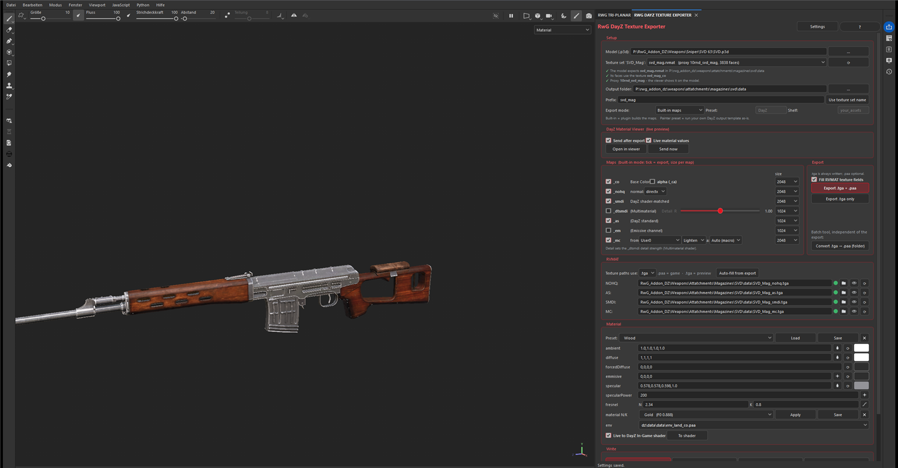
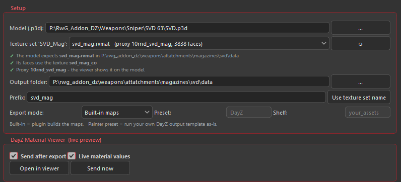
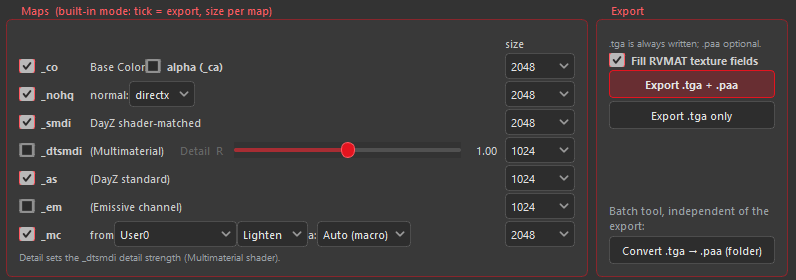
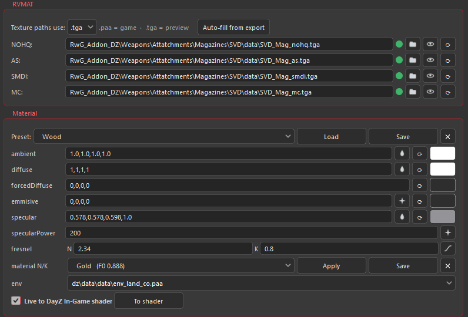
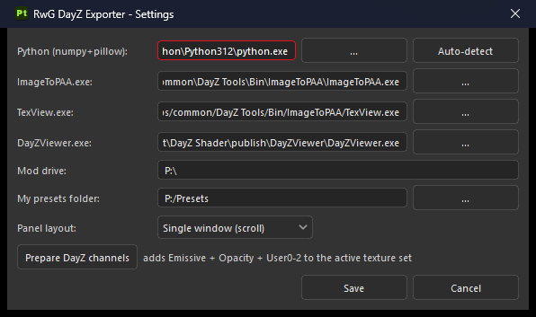
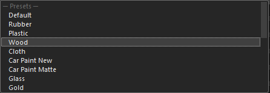
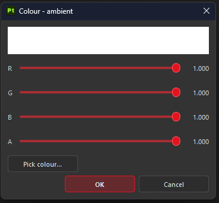
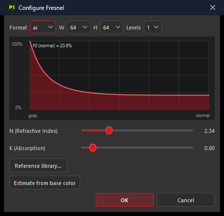
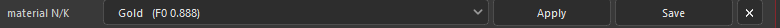

# RwG DayZ Texture Exporter — Complete Guide

A **Substance 3D Painter** plugin that turns a normal PBR (metal/rough) project
into game-ready **DayZ / Enfusion** textures (`_co` / `_ca`, `_nohq`, `_smdi`,
`_as`, `_em`, `_mc`), converts them to `.paa`, and writes a complete **Super
shader `.rvmat`** — damage / destruct variants included — all from a dock inside
Painter.

> This document is a full manual. Each `##` section is self-contained and can
> become its own wiki page; the Table of Contents maps to them. Look for the
> **Tip** call-outs.



---

## Table of contents

1. [How DayZ shading works (read this first)](#how-dayz-shading-works-read-this-first)
2. [Painting metal/rough that converts well](#painting-metalrough-that-converts-well)
3. [Requirements](#requirements)
4. [Installation](#installation)
5. [First export in 5 minutes](#first-export-in-5-minutes)
6. [Baking maps in Painter for DayZ](#baking-maps-in-painter-for-dayz)
7. [Normal maps done right (`_nohq`)](#normal-maps-done-right-_nohq)
8. [The panel & layout](#the-panel--layout)
9. [Setup tab](#setup-tab)
10. [Maps tab — `_co` (Base Color)](#maps-tab--_co-base-color)
11. [Maps tab — `_smdi` (DayZ shader-matched)](#maps-tab--_smdi-dayz-shader-matched)
12. [Maps tab — `_nohq`, `_as`, `_em`, `_mc`](#maps-tab--_nohq-_as-_em-_mc)
13. [The Multimaterial shader (in depth)](#the-multimaterial-shader-in-depth)
14. [UV layout for DayZ](#uv-layout-for-dayz)
15. [Export & `.paa`](#export--paa)
16. [RVMAT tab — texture stages](#rvmat-tab--texture-stages)
17. [RVMAT tab — presets](#rvmat-tab--presets)
18. [RVMAT tab — material colours & estimates](#rvmat-tab--material-colours--estimates)
19. [RVMAT tab — fresnel & the material N/K library](#rvmat-tab--fresnel--the-material-nk-library)
20. [RVMAT tab — env, write, load, shader link](#rvmat-tab--env-write-load-shader-link)
21. [Damage variants](#damage-variants)
22. [From rvmat to in-game: Object Builder & config](#from-rvmat-to-in-game-object-builder--config)
23. [Settings & Prepare DayZ channels](#settings--prepare-dayz-channels)
24. [Project vs global settings](#project-vs-global-settings)
25. [Recipes & workflows](#recipes--workflows)
26. [Walkthrough: a material accent with `_mc`](#walkthrough-a-material-accent-with-_mc)
27. [The RwG DayZ viewport shader (`dayz-ingame`)](#the-rwg-dayz-viewport-shader-dayz-ingame)
28. [Troubleshooting & FAQ](#troubleshooting--faq)
29. [Packing, testing & common in-game errors](#packing-testing--common-in-game-errors)
30. [Known limitations](#known-limitations)
31. [Reference tables](#reference-tables)
32. [Changelog](#changelog)
33. [Credits & license](#credits--license)

---

## How DayZ shading works (read this first)

Understanding this one thing makes every option in the plugin obvious.

Most artists paint in the **metal/rough** model: a `baseColor`, a `metallic`
mask, and a `roughness` map. DayZ's **Enfusion "Super" shader** does **not** use
that model. It uses **specular / glossiness**:

- **Colour lives in the `_co`** — for dielectrics *and* metals. The shader takes
  the reflected part off the direct light by itself (`diffuse × (1 − Fresnel × G)`)
  and does **not** darken the ambient light (`ambient[] × sky × _co`). A `_co`
  that is already darkened for metals would be darkened twice, and a black metal
  goes black in the shade.
- **`_smdi` is grayscale.** `G` scales the reflection (`G × Fresnel(angle)`),
  `B` scales the highlight exponent (`B × specularPower`). It decides how *shiny*
  the surface is, **not** what *colour* it is.
- **`fresnel(N,K)`** (Stage6) is a physical complex-IOR Fresnel curve: it carries
  the reflectance at head-on view (**F0**) *and* its rise toward grazing angles.
- **`specular[]`** tints highlight and reflection — the metal's hue. The engine
  also brightens the highlight by about `0.11 × specularPower`.
- **`env`** (Stage7) is the reflection cubemap — without it, metal looks flat.

These rules were measured with RenderDoc in the game and checked against a
pixel-identical rebuild of the Super shader (the DayZ Material Viewer). So the
plugin's job is a **metal/rough → DayZ conversion** that matches them:

| Metal/rough input | Goes to |
|---|---|
| baseColor (colour — dielectric *and* metal) | `_co`, unchanged |
| metallic + roughness + baseColor | `_smdi` (G relative to the fresnel stage, B relative to specularPower) |
| the metal's hue / reflectance | `specular[]` tint, `fresnel(N,K)` |
| normal + height | `_nohq` |
| AO | `_as` |
| emissive | `_em`, `emmisive[]` |

> **Tip:** If a metal looks flat/greyish in-game, it's usually a missing **env**
> map, a dielectric **fresnel** on a metal, or a white `specular[]` where the
> metal's hue belongs — not the `_co`. Check those first.

The dielectric reflectance constant used everywhere is **F0 = 0.04** (4 %), the
standard non-metal reflectance — `fresnel(1.5, 0)`.

---

## Painting metal/rough that converts well

You keep painting the way you always have — metal/rough, in Painter, with your
own smart materials. Nothing here asks you to author spec/gloss by hand. But the
conversion the plugin runs is **mechanical**: it reads your channels and applies
the formulas from the previous section, and it has no way to guess what you
*meant*. A base colour that drifts out of range or a metalness mask full of grey
converts exactly as faithfully as a good one — into a worse DayZ material. A
little discipline in the four input channels is what separates a material that
lands first try from one you fight in the rvmat afterwards.

**Base colour** carries more weight here than in a standard PBR pipeline, because
it feeds two things at once. For **dielectrics** — cloth, wood, plastic, paint —
keep the albedo in a sane range: no pure black, no pure white, roughly 30 to 240
in 8-bit sRGB terms. The default `_co` source takes the base colour through
essentially untouched, so anything crushed to 0 or blown to 255 arrives in-game as
a surface with no shading information left in it, and no lighting condition will
bring it back. For **metals**, the base colour is doing something else entirely:
it *is* the reflectance tint. The `_co` keeps the metal's colour rather than
blacking it out, and the `_smdi` derives its specular level from the brightness
of `mix(0.04, base, metallic)` — so a brass that is painted too dark reads as a
dull, weakly reflective brass, and the **specular estimate** droplet in the RVMAT
tab pulls its tint from that same base colour. Get the metal's colour right in
Painter and three separate parts of the export inherit it for free.

**Metallic** wants to stay close to binary. A pixel is metal or it isn't, and the
in-between values only make physical sense as a transition — the worn edge where
paint has rubbed through to bare steel, the boundary of a rust patch. Everywhere
else, grey metalness converts into a muddy specular: the conversion mixes between
the dielectric 0.04 and the base colour's brightness, so a mask sitting at 0.5
lands the surface halfway between "plastic" and "metal", which is a look nothing
in the real world has. Paint the mask with hard values and let the roughness and
the base colour do the storytelling in between.

**Roughness** becomes the gloss — `B = (2/roughness⁴ − 2) / specularPower`, the
highlight exponent the roughness stands for — and it is the channel that most
often gets left flat. A metal with one uniform roughness reads as
**plastic** in-game no matter how good its specular tint is, because real metal is
never uniformly polished: the high points of a casing are burnished, the recesses
hold dirt, the scratches are rougher than the surface around them. Give it that
variation in Painter and the `_smdi` carries it through. The smoothest area sets
the rvmat's **specularPower** (the estimate button sizes it for you); every rougher
pixel is a fraction of it.

**Height** is the channel people skip, and it is the one that decides whether the
surface has any micro-detail at all. Painter's converted normal folds height into
the `_nohq`, and the `_dtsmdi` detail channel is built from height plus the baked
mesh normal — so if there is no real height, painted or baked, both maps have
nothing finer than the silhouette to work with. Pores, weave, grain, tool marks:
they live in height.

Then **check the conversion before you commit to it**. Look at the surface
through the companion **`dayz-ingame`** viewport shader (RwG DayZ SP Shader),
which converts your channels live the way the export does and shades them with
DayZ's Super shader and in-game light — or send the export to the **DayZ
Material Viewer**, which shows the real model the way the game does. Painter's
standard viewport will happily show you a beautiful metal/rough material that
converts into a disappointing DayZ one; both previews show you the version the
game will actually render, while you can still fix it in the layer stack.

> **Tip — the fastest metal there is.** Paint metal/rough as normal → on the RVMAT
> tab **Load** the metal's preset (or **material N/K → Apply**) and click the
> **specular estimate** droplet to pull the exact tint straight out of your base
> colour → set an **env** map → export. The `_smdi` is computed against exactly
> that fresnel and specularPower. See RVMAT tab — material colours & estimates.

> **Tip — judge roughness by the highlight, not the value.** Whether `0.35` is
> right for a given metal is unanswerable in the abstract; what you can judge is
> whether the highlight is tight and bright or broad and soft. Paint until the
> highlight looks right in the `dayz-ingame` viewport or the viewer, and the
> `_smdi` will carry exactly that.

---

## Requirements

- **Substance 3D Painter** — PySide6 (2024+) or PySide2 (older); both handled.
- A **Python** with `numpy` + `pillow` (`pip install numpy pillow`) — runs the
  image conversion outside Painter. **Auto-detect** is in Settings.
- **DayZ Tools `ImageToPAA.exe`** — only for `.paa` output.
- Optional: the **DayZ Material Viewer** (live preview of the model with DayZ's
  shading), the **RwG DayZ SP Shader** (`dayz-ingame` viewport shader) and
  **TexView / TexView2** to open textures from the RVMAT tab.

---

## Installation

1. Copy the **`RwG_DayZ_Painter`** folder into
   `…\Documents\Adobe\Adobe Substance 3D Painter\python\plugins\`.
2. Restart Painter, or **Python → Reload Plugins**.
3. Open the panel via the dock, the toolbar icon, or the **Window** menu.
4. In **Settings**, set **Python** (Auto-detect) and, for `.paa`, **ImageToPAA**
   (optional: **DayZViewer.exe** for the live preview).

**Updating:** close Painter and replace the whole `RwG_DayZ_Painter` folder. Your
own presets live in the *My presets folder* (Settings) and stay untouched.

---

## First export in 5 minutes

1. Open your textured project.
2. **Settings** → set **Python** and your **Mod drive** (e.g. `P:\`).
3. **Setup** → **Model (.p3d)** (usually found by itself) → pick the **Texture
   set** material. That sets **Output folder** and **Prefix**; the ✓ lines confirm
   the export lands where the model expects it. (Without a model: Output folder
   inside your `P:\` mod path + a Prefix.)
4. **RVMAT** → pick a **Preset** → **Load** (sets fresnel + specularPower, which
   the `_smdi` is computed against).
5. **Maps** → tick the maps, pick resolutions → **Export .tga + .paa** (or
   **Export .tga only**).
6. **RVMAT** → **Auto-fill from export** → **Write .rvmat**.

---

## Baking maps in Painter for DayZ

Baking is what makes the DayZ maps carry any surface detail at all. The plugin
does not read your mesh — it reads Painter's channels, and two of them are built
*from* the bakes: the `_nohq` comes out of Painter's converted normal, which
combines the painted **Normal** channel with the **Height** channel *and* the
baked **mesh normal**, and the `_as` is the baked **ambient occlusion** (mixed
with any AO you paint) written into the green channel. Bake nothing and both maps
come out flat: a `_nohq` that only holds what you painted by hand, and an `_as`
that shades nothing. The optional `_dtsmdi` detail channel leans on the same
sources, so it is just as dependent on a good bake.

Bake from **Texture Set Settings → Mesh Maps → Bake Mesh Maps**. For a DayZ asset
the useful set is **Normal** and **Ambient Occlusion** (the two the plugin
consumes directly), plus **Curvature**, **Position**, **Thickness** and
**World-space Normal**, which nothing in the export reads but almost every smart
mask and generator does — leave them out and your edge wear, dirt and cavity
masks have nothing to work with. If you have a high-poly, also bake a
**Height**/displacement source: that is the one bake that feeds real sculpted
depth into the `_nohq` instead of leaving it to the painted normal alone.

How you bake depends on what you have. With a **low-poly plus a high-poly**,
Painter matches the two by name (the `_low` / `_high` suffixes, or *Match: By Mesh
Name*) and projects the high-poly's detail down onto the low-poly's UVs — this is
the route that gives you sculpted normals, real AO and a usable height bake. With
only the game mesh, tick **Use Low Poly Mesh as High Poly** and Painter bakes the
mesh against itself: you still get honest AO, curvature and thickness from the
low-poly's own shape, but the normal bake carries nothing the mesh doesn't already
have, and there is no height to speak of. That is fine for hard-surface props
whose detail is painted anyway; it is not fine for anything you sculpted.

Set the **output size** to the resolution you actually export at — bake 2048 for
a hero prop, 1024 for a small item — because a 1024 bake stretched into a 2048
export throws away exactly the detail you baked for. Turn **antialiasing** up to
2×2 or 4×4; the subsampling costs bake time and removes the stair-stepping along
every UV edge, which is cheap insurance for a map that gets compressed. Be
generous with the **dilation width** (the padding Painter floods outside each UV
island): `.paa` conversion builds a full mip chain, and every mip level averages
pixels from further outside the island, so padding that looked sufficient at full
resolution starts pulling background into your seams a few mips down. A wider
dilation costs nothing at runtime and is the difference between clean seams and
dark lines appearing as the object moves away from the camera.

Projection distance is the other thing worth getting right. Painter shoots rays
along the low-poly's normals over a **max frontal distance** (and a rear distance
behind the surface); anything the ray reaches within that envelope gets baked.
Too short and details drop out in holes and hard patches; too long and rays from
one part of the mesh hit a neighbouring surface, which is what produces skewed
normals, **haloing** around raised details and smears of wrong AO in corners and
along edges. The fix, in order: shrink the frontal distance until the bleeding
stops but the detail still lands; if the mesh has parts at very different scales,
give it an explicit **cage** mesh so the envelope follows the silhouette instead
of one global number; and split UVs (or use *Average Normals* selectively) where
hard edges meet, since that is where skew shows first.

> **Tip:** Bake once into a Painter **project template** together with **Prepare
> DayZ channels**. A template that already carries the mesh maps and the
> Emissive / Opacity / User0-2 channels means every new item starts export-ready —
> no half-finished `_nohq` because someone forgot to bake, no missing `_mc`
> because the User channels were never added.

> **Tip:** DayZ reads AO from the **green** channel of the `_as`, and nothing else
> in the material cancels it out. Keep the bake pure occlusion — no baked-in
> lighting, no colour bleed from the high-poly's materials, no ID pass leaking in
> — or the whole surface reads as dirty in-game and no amount of `_co` correction
> will lift it back out.

---

## Normal maps done right (`_nohq`)

DayZ reads normals in the **DirectX** convention: the green channel points
**down**, so a bump's lower edge is the bright one. OpenGL-convention maps — what
most sculpting and baking tools hand you by default — have green pointing up, and
the two look identical in a thumbnail while shading the surface backwards in the
game. The plugin writes DirectX by default and remembers the choice **per
project**, so you set it once per asset and forget it.

The symptom of the wrong convention is unmistakable once you know it: the surface
reads as **inverted** — rivets punch inward, panel gaps stand proud, and the whole
thing looks lit from the wrong side, as if the sun were somewhere below the
horizon. It is at its most obvious on a raking light in Buldozer or on the first
in-game sunrise. The fix is one control: flip the **normal format**
(`opengl` / `directx`) on the `_nohq` row on the Maps tab and re-export. Nothing
else in the pipeline needs touching, and because the setting travels with the
project, you only pay for the mistake once.

What actually goes into the map is more than the Normal channel. The plugin hands
Painter's **converted normal** through, which composes the painted **Normal**
channel with the **Height** channel *and* the baked **mesh normal** — so a `_nohq`
is never flat, even on an asset where nobody painted a single normal stroke. That
composition is also why the map is only ever as good as its sources: the baked
mesh normal carries the silhouette-level shapes, and the height carries everything
finer. Without a real height or detail source — sculpted, baked, or painted with
height-driven materials — you get correct large forms and a surface that is
microscopically dead: no pores in leather, no weave in canvas, no tool marks in
metal. Those live in height, not in the bake.

Mirrored UVs deserve a look before you call the map done. An island that is
mirrored runs with a flipped tangent basis, which effectively inverts the red (X)
channel across the mirror line, and detail with a clear direction — screw slots,
brushed metal, stitching, anything with a lit and a shadowed side — can end up
lighting one half opposite to the other. Painter's viewport is more forgiving here
than the game is, so judge it in **Buldozer or in-game**, on a rotating light, not
in the paint view. The cheap structural fix is to keep important, directional
detail **off the seam** and off the mirror line entirely: put the seams where the
geometry already breaks up, and let the mirrored halves carry surface texture
rather than the feature you want people to read.

The `_dtsmdi` detail channel is a different thing and does not replace any of
this. Its red channel is a **high-frequency micro-detail** signal centred on
**0.5**, tiled over the surface for close-up richness, while the `_nohq` remains
the actual normal map with your baked and painted shapes. The two **stack**: the
Multimaterial shader takes its surface direction from the `_nohq` and adds the
detail on top. So a strong `_dtsmdi` never compensates for a weak `_nohq`, and
turning the detail up because the normal looks flat only produces a busy surface
that is still flat underneath. See the `_dtsmdi` sub-section under
Maps tab — `_nohq`, `_as`, `_em`, `_mc`.

> **Tip:** Resist the urge to crank the normal strength. DayZ's lighting is
> subtle and its assets sit in a fairly flat, overcast world, so a normal map
> that looks impressive in a studio HDRI usually reads as **noise** in the game —
> and worse once the mips kick in: high-contrast normals average toward grey with
> distance, so the detail doesn't fade gracefully, it turns into shimmer and
> crawl. Aim for a map that looks slightly understated up close; that is the one
> that still reads correctly at ten metres.

---

## The panel & layout



Three tabs — **Setup**, **Maps**, **RVMAT** — with **Settings** and **?** at the
top and a **status line** at the bottom that reports the result of every action.
Prefer one page? **Settings → Panel layout → Single window**. The choice is
global.







> **Tip:** When something doesn't work, read the status line first — it names the
> exact reason (missing channel, no output folder, no Python, …).

---

## Setup tab

### Model first

- **Model (.p3d)** — the Object Builder model this project paints. Found by
  itself next to the mesh Painter imported, next to the `.spp` or in/above the
  output folder; pick it with `...` otherwise.
- **Texture set** — which material of the model the *active* texture set paints.
  The list holds the model's rvmats **and those of its proxies** (a weapon's
  stock, handguard, magazine … with their own P3D and data folder), read straight
  from the P3D. Choosing one sets **Output folder** (the rvmat's folder) and
  **Prefix** (its name). The choice is remembered **per texture set**, so
  switching texture sets in Painter switches the paths too; a matching name is
  suggested.
- **Check lines** (✓/✗) — does the export write the `.rvmat` and the `_co`
  where the model's faces expect them?
- Paths always stay in `P:\` form — also when a file dialog returns the real
  folder behind the work drive (`subst` target, mods linked into `P:` by
  junction).

Only MLOD models are read (what Object Builder saves); binarized models and
proxies are skipped.

### Output, prefix, export mode

- **Output folder** — where the textures land (set by the texture-set choice, or
  by hand). Inside your `P:\` mod path the `.rvmat` gets game-valid, mod-relative
  texture paths.
- **Prefix** — the file-name base (`wall` → `wall_co.tga`). **Use texture set
  name** fills it from the active set.
- **Export mode**:
  - **Built-in maps** — the plugin builds each map (recommended).
  - **Painter preset** — runs your *own* saved Painter export preset as-is (no
    external Python needed). Set the **preset name** + **shelf**.

### DayZ Material Viewer (live preview)

The DayZ Material Viewer shows the real model with DayZ's own shading (a
pixel-identical rebuild of the Super shader, the game's lighting presets, shadows,
SSAO and anti-aliasing).

- **Send after export** — after every export the viewer reloads the written
  textures and `.rvmat`; for a proxy's material it switches that proxy on.
- **Live material values** — ambient, diffuse, forcedDiffuse, emmisive,
  specular, specularPower and fresnel go to the viewer **while you edit them**,
  applied to every face using `<prefix>.rvmat` — no save needed. It works both
  ways: values edited in the viewer's material panel come back into the plugin
  (and from there into the `dayz-ingame` viewport shader).
- **Open in viewer** starts `DayZViewer.exe` (path in Settings) with the model;
  **Send now** sends model, current textures and values without exporting.

> **Tip:** One texture set per rvmat, with the model set, and the paths take care
> of themselves. The plugin finds `<prefix>_*.tga` by folder + prefix, so keep
> them tidy when you set them by hand.

---

## Maps tab — `_co` (Base Color)

`_co` is the colour map (assigned on the model, not an rvmat stage). It is the
project's **Base Color**, unchanged — metals keep their colour.

Why only this one: the Super shader already takes the reflected part off the
direct light (`diffuse × (1 − Fresnel × G)`) and lights the ambient part with the
full `_co` (`ambient[] × sky × _co`). A `_co` that is darkened for metals
(Painter's Diffuse, the glTF spec/gloss diffuse, Base Color + Specular) loses that
energy twice, and a black metal turns black in the shade. A baked 2D view would
carry Painter's lighting into the game's. Earlier versions offered those sources;
since v0.6.0 the `_co` is always Base Color.

Tick **alpha (`_ca`)** to add an **Opacity** alpha and write the file as `_ca`
instead of `_co` — for transparent materials (glass, foliage, decals).

> **Tip — metals in `_co`:** metals *keep* their colour in `_co` — that's
> intended, not a bug. The metal's hue in the reflection comes from the rvmat
> `specular[]` (see the material colours / N/K library sections).

---

## Maps tab — `_smdi` (DayZ shader-matched)

`_smdi` packs `R = white`, **`G` = specular level**, **`B` = gloss**. The plugin
builds it the way the game's Super shader reads it (measured with RenderDoc):

- the reflection is `G × Fresnel(angle)`, where the rvmat's `fresnel(N,K)` stage
  **already carries F0**;
- the highlight exponent is `B × specularPower`;
- the engine brightens the highlight by about `0.11 × specularPower` for the
  whole material.

So, from metallic + roughness + base colour:

```
F0 = perceivedBrightness(mix(0.04, linear baseColor, metallic))
G  = F0 / F0(fresnel N,K) × B
B  = (2 / roughness⁴ − 2) / specularPower
```

`perceivedBrightness(c) = sqrt(0.299 R² + 0.587 G² + 0.114 B²)`.
`G` is the fraction of the stage's reflectance this pixel has; `× B` keeps rough
areas from a full-strength highlight (the engine's brightening is per material,
`B` corrects it per pixel). `B` is the Blinn-Phong exponent of the roughness
relative to the rvmat's specularPower.

**Set specularPower and fresnel N/K first** (RVMAT tab — a preset, material N/K,
or the estimate buttons), then export. Choose the fresnel of the **most
reflective** material in the texture set (usually the metal): pixels reflecting
more than the stage are clipped to `G = 1`. The specularPower estimate sizes it for
the smoothest part, at most **400** — the `_smdi` is BC1-compressed in game, and a
larger value would crush the rough range.

Why the older methods are gone: glTF / PBR / Met+Rough / Spec+Gloss wrote F0 into
`G`, which the shader multiplies with the fresnel stage again — reflections came
out up to ~25× too weak — and a linear `1 − roughness` gloss doesn't match the
exponent. The G/B sliders went with them; the material defines both.

> **Tip — the colour still isn't here.** `_smdi` is grayscale on purpose. Set the
> metal's colour in the rvmat `specular[]` (one click: the **specular estimate**
> droplet, or the **material N/K** library). See below.

---

## Maps tab — `_nohq`, `_as`, `_em`, `_mc`

### `_nohq` (normal)

Built from Painter's converted normal (normal channel **+ height + baked mesh
normal**, never flat). DayZ expects **DirectX** normals; the format
(`opengl`/`directx`) is switchable and **remembered per project**.

> **Tip:** If a surface looks "inverted" / lit from the wrong side in-game, flip
> the normal format here.

### `_as` (ambient shadow)

DayZ layout: R/B white, **G = mixed AO**. 512 is usually plenty.

### `_em` (emissive) — optional

The Emissive channel saved as-is. DayZ multiplies it by the material's
`emmisive[]`. Needs an **Emissive** channel (see *Prepare DayZ channels*).

### `_mc` (macro) — optional

A detail/macro overlay from a Painter **User** channel — or several combined:

- **Source**: `User0` / `User1` / `User2`, or **Combine (User0-2)** with a
  **blend mode** (Lighten / Screen / Add / Overlay / Average / Multiply / Darken).
- **Alpha (blend mask)**: **Auto (macro)**, None, a User channel, or Opacity.
  DayZ uses this alpha to blend macro over the base (`1 = only macro`,
  `0 = only base`).

> **Tip:** Needs the **User0-User2** channels. Add them (plus Emissive + Opacity)
> in one click with **Prepare DayZ channels** in Settings — best baked into a
> project template.

### `_dtsmdi` (Detail + SMDI) — optional

The **Multimaterial** shader replaces the normal `_smdi` with a `_dtsmdi`, which
packs a fine **detail map** into the red channel while keeping the same specular /
gloss in green / blue:

- **`R` = detail** — a high-frequency detail map combined from **height + baked
  mesh + normal**. Painter's converted normal is always used; the raw **Height**
  channel is added when the project has one. Each source is high-passed (its
  low-frequency shape removed) and the deltas are summed around a neutral **0.5**,
  so the map fades out in the mip-chain instead of darkening the surface.
- **`G` = specular level, `B` = gloss** — built exactly like the `_smdi`
  (DayZ shader-matched).

A **Detail** slider on the `_dtsmdi` row (active only when `_dtsmdi` is ticked)
scales *how pronounced* the detail is. It only changes the
**amplitude** of the detail around 0.5 — the map's average stays **0.5** (BI's
"average 0.5, fades in the mipmaps" rule), so a higher value just makes the detail
crisper, never brighter/darker overall. `1.00` = default.

Tick **`_dtsmdi`** on the Maps tab and give it its own resolution; it's written as
`<prefix>_dtsmdi`. In the `.rvmat` this is the map the Multimaterial shader reads
in place of the Super shader's `_smdi`.

> **Tip:** `_dtsmdi` and `_smdi` are alternatives — the Super shader uses `_smdi`,
> the Multimaterial shader uses `_dtsmdi`. You don't normally need both for the
> same material.

---

## The Multimaterial shader (in depth)

Everything up to here assumes the **Super** shader: one material, one set of maps,
one look across the whole object. The **Multimaterial** shader exists for the case
that breaks — a mesh that needs several *tiling* materials at once, blended by a
mask rather than split into face selections. A concrete wall with exposed brick
and moss creeping up it, a vehicle body with paint, bare metal and rust, a wooden
crate with a metal band: with Super you would either bake all of it into one
unique `_co` (and lose resolution) or split the mesh into separate materials (and
pay for the draw calls). Multimaterial blends up to **four** materials on one
material slot, each free to tile as densely as it likes.

The price is a **second UV set**. The four base materials tile — they are laid out
to repeat many times across the surface, so their UVs say nothing about *where* on
the object you are. The blend mask has the opposite job: it must be unique across
the mesh, because it is the thing that says "brick here, moss there". Those two
requirements can't share one UV layout, so the shader reads from two: the tiling
colour/detail layers on **UV0**, and the mask (plus the macro and AO, which are
equally position-dependent) on **UV1**. That split is the whole reason the shader
needs more mesh prep than Super does.

In the `.rvmat` the shader is selected by name — `PixelShaderID="Multi"` and
`VertexShaderID="Multi"` — alongside the usual material block. Treat those
identifiers, and every stage index below, as the **typical layout — verify against
a known-good Multimaterial rvmat** from the game data or a working mod before you
commit to it; the exact naming and the stage count differ between shader versions,
and the engine will not tell you politely when a stage lands in the wrong slot.

| Stage | Content | Typical UV |
|---|---|---|
| Stage0–3 | The four base colour layers — one `_co` per layer (layer 0 is the base) | `tex` (UV0), tiling |
| Stage4 | The **RGB blend mask**: `R` → layer 1, `G` → layer 2, `B` → layer 3; black = the base layer | `tex1` (UV1), unique |
| Stage5–8 | One **`_dtsmdi`** per layer — Detail + SMDI, which is why `_dtsmdi` takes the place of `_smdi` here | `tex` (UV0), tiling |
| Stage9 | `_mc` (macro) | `tex1` (UV1) |
| Stage10 | `_as` (ambient shadow) | `tex1` (UV1) |
| Stage11–14 | One `_nohq` per layer | `tex` (UV0), tiling |

Which UV a stage reads is not baked into the stage — each one points at a
**TexGen** block (`TexGen0`–`TexGen7`), and the TexGen carries the `uvSource`:
`"tex"` for UV0, `"tex1"` for UV1, `"tex2"` for UV2 where a mesh has a third. There
are fewer TexGens than stages because stages share them: all four colour layers,
all four `_dtsmdi` and all four `_nohq` can ride the same tiling TexGen, while the
mask, macro and `_as` share the unique-UV one. A TexGen also holds a `uvTransform`,
which is where per-layer tiling scale lives — so "make the brick tile twice as
often" is a TexGen edit, not a re-export.

Authoring one is less exotic than the stage list suggests. Build each material as
its own normal DayZ export — a `_co`, a `_dtsmdi` and a `_nohq` per layer, exported
exactly the way this guide describes everywhere else; the plugin's **`_dtsmdi`**
export *is* the per-layer Detail+SMDI the shader wants (see the `_dtsmdi`
sub-section under Maps tab — `_nohq`, `_as`, `_em`, `_mc`).
Then paint the **mask** as a separate map on the second UV: pure red where layer 1
should win, green for layer 2, blue for layer 3, black where the base layer should
show through, and soft gradients wherever you want the transition to be gradual
rather than a hard line. Wire the maps into the stages, point the TexGens at the
right UV sources, and set the tiling in the `uvTransform`.

> **Tip — the mask is literal.** The blend mask's channels *are* the layers: **R =
> layer 1, G = layer 2, B = layer 3, black = the base layer**. There is no lookup
> table and no ordering to remember. Paint pure channel colours where a material
> should win outright, mid-tones where two should mix, and keep the mask's own
> resolution modest — it describes *where*, not *what*, so it rarely needs the
> resolution the tiling layers do.

> **Tip — two UVs is real work.** A second UV set means unwrapping the mesh twice
> in Object Builder, keeping both layouts intact through every edit, and a rvmat
> with four times the stages to get wrong. That is worth it for a surface that
> genuinely needs three or four *tiling* materials — terrain-like props, large
> structures, vehicle bodies. For a knife with two brass rivets, it isn't: use a
> macro accent (see the `_mc` walkthrough) or a second face selection instead.

---

## UV layout for DayZ

The UVs decide how much of everything else survives. Every map the plugin writes
is sampled through them, so a layout that wastes space or crowds its islands
undoes good bakes and good painting before the material ever reaches the game.

The first thing to get right is **texel density** — how many pixels of texture
cover a given amount of surface. Keep it **consistent across the item**: if the
grip of a tool is packed at twice the density of its head, the head reads as soft
and slightly out of focus next to it, and no export setting fixes that, because
the difference is baked into the layout. Pick the density from the object's
**real, in-game size** and how close a player gets to it, not from how it looks
filling your viewport — a crate is metres across and mostly seen from a few paces,
a canteen is held at arm's length, and they need very different pixel budgets to
look equally sharp. The practical calibration is to compare against a vanilla item
of similar size and use: match its density, and your item sits correctly next to
everything else in the world instead of standing out as unusually crisp or
unusually blurry. The map resolutions on the Maps tab are then just the arithmetic
that follows from the density you chose.

Second: **padding**, and where the seams go. Leave real margin between islands —
`.paa` conversion builds a full mip chain, and each mip averages a wider
neighbourhood, so islands that merely don't touch at full resolution start
bleeding into each other a few levels down. That shows up in-game as coloured
fringes along seams that get worse with distance, which is the same failure mode
the bake dilation guards against on the other side of the pipeline (see
Baking maps in Painter for DayZ) — both matter,
because dilation fills the gap and padding provides the gap to fill. While you are
placing the cuts, hide them: put seams under straps, inside recesses, along hard
edges and on the side nobody looks at, and keep them off large flat panels where
the eye follows an unbroken surface.

The **Multimaterial** shader is the case that needs a **second UV set**, and it is
worth understanding why rather than copying a setup. UV0 — `tex` in the rvmat's
TexGen blocks — carries the tiling base materials: those islands are laid out to
repeat many times across the surface, so their coordinates deliberately run far
outside 0–1 and say nothing about *where* on the object a given point is. The mask
needs exactly the opposite. It is unpacked **0–1 with no tiling**, one island per
region, so that every point of the surface maps to exactly one point of the mask
and painting red at a spot puts layer 1 at that spot. That layout lives on a second
UV set — `tex1` — and the macro and `_as` usually ride along on it, since they are
equally position-dependent. Which stage reads which set is not a property of the
texture but of the TexGen it points at, as described in
The Multimaterial shader (in depth); the
layout itself is created and edited in your DCC — Blender, Object Builder, whatever
you model in — not in Painter and not by the plugin.

> **Tip — one UV is the normal case.** A single-material Super-shader prop needs
> **one** UV set, unwrapped 0–1, and nothing more. The second UV set is
> specifically the Multimaterial mask channel; adding one to an ordinary item buys
> you nothing and gives you a second layout to keep intact through every mesh edit.

> **Tip — decide density before you unwrap, not after.** Rescaling islands later
> means re-baking every mesh map and often repainting height-driven detail, since
> the same brush now covers a different number of texels. Set the density on the
> first island, match everything to it, and the rest of the pipeline stays cheap.

---

## Export & `.paa`

The **Export** card sits next to **Maps**:

- **Export .tga + .paa** — writes the ticked maps as `.tga` and runs
  **ImageToPAA**.
- **Export .tga only** — `.tga` only (always available).
- **Fill RVMAT texture fields** — after an export, writes the produced paths into
  the RVMAT tab's NOHQ / AS / SMDI / MC fields.
- **Convert `.tga → .paa` (folder)** — batch-convert every `.tga` in a folder.

The conversion runs in the background, so Painter stays responsive. With **Send
after export** (Setup) the DayZ Material Viewer reloads the result right away.

> **Tip:** `.tga` is your editable/previewable copy; `.paa` is what the game
> packs. Keep both — the rvmat can reference either (set the **Texture paths use** on
> the RVMAT tab).

---

## RVMAT tab — texture stages

The Super-shader stage layout the plugin writes:

| Stage | Map | Field |
|---|---|---|
| 1 | NOHQ (normal) | **NOHQ** |
| 2 | DT (detail) | procedural default |
| 3 | MC (macro) | **MC** |
| 4 | AS (ambient shadow) | **AS** |
| 5 | SMDI (specular) | **SMDI** |
| 6 | FRESNEL | `fresnel(N,K)` |
| 7 | ENV | **env** |

`_co` is **not** a stage — it's assigned on the model.

Each texture field (**NOHQ / AS / SMDI / MC**) has three icon buttons: **browse**
(pick a file, stored mod-relative), **open** (view in TexView / default app), and
**default** (reset to the procedural value). **Texture paths use** picks `.paa`/`.tga`
(default `.tga`), and **Auto-fill from export** fills NOHQ/AS/SMDI with the real
exported paths.

Behind each field is a small **availability light** that checks the disk live:
**green** = the referenced file exists, **amber** = only the *other* extension is
there (so convert it, or switch **Texture paths use**), **red** = nothing found,
**grey** = a procedural default (nothing to check). Hover it for the resolved
path. It's a quick way to catch a typo'd path or a `.paa` you forgot to convert
before the material ever reaches the game.

> **Tip:** Store paths **mod-relative** — set your **Mod drive** (`P:\`) in
> Settings and keep the output inside it, or "Auto-fill from export" will fall back
> to a folder-relative path.

---

## RVMAT tab — presets

One grouped **Preset** dropdown holds two groups:

- **— Presets —** — built-in materials: **Default, Rubber, Plastic, Wood, Cloth,
  Car Paint New, Car Paint Matte, Glass, Gold, Iron, Aluminum, Copper, Brass,
  Silver, Steel, Titanium, Nickel, Chrome**.
- **— My presets —** — presets you saved.

Since v0.6.0 the built-in presets follow what the shader does with each value:

- `ambient` / `diffuse` = **1** — the colour comes from the `_co`.
- **Dielectrics** (Rubber, Plastic, Cloth, Car Paint, Glass): **white**
  `specular[]` and the dielectric fresnel `1.5, 0` (F0 = 0.04); Wood `1.5, 0.45`.
  Only specularPower differs (Cloth 4 … Glass 400).
- **Metals**: the `specular[]` carries the metal's **hue** (normalised, brightest
  channel 1 — e.g. Gold `1, 0.78, 0.34`), the fresnel N/K its reflectance (BI
  values), and specularPower ≤ **400**.
- **Default** keeps BI's `fresnel(0.4, 0.2)`.

| Preset | specular[] | specularPower | fresnel N, K |
|---|---|---|---|
| Plastic | 1, 1, 1 | 35 | 1.5, 0 |
| Wood | 1, 1, 1 | 45 | 1.5, 0.45 |
| Gold | 1, 0.78, 0.34 | 400 | 0.3, 3 |
| Iron | 0.97, 0.98, 1 | 60 | 3.12, 3.87 |
| Steel | 0.97, 0.98, 1 | 180 | 3.12, 3.87 |
| Copper | 1, 0.67, 0.57 | 200 | 2.08, 7.15 |
| Brass | 1, 0.81, 0.46 | 200 | 0.44, 3.0 |
| Chrome | 0.98, 0.99, 1 | 400 | 3.0, 3.3 |



Buttons: **Load** fills *all* material values from the selection; **Save** stores
the current values as one of *your* presets (asks a name); **✕** deletes one of
yours (built-in presets can't be deleted).

Your presets save only the **values** (ambient / diffuse / forcedDiffuse /
emmisive / specular / specularPower / fresnel N,K / env). Loading one **resets the
texture stages to their procedural defaults** — so a preset is a portable
*material look*, not tied to any texture paths. The presets file lives in a
folder you can set in **Settings** (empty = next to the plugin; a synced folder
shares them across machines).

> **Tip:** Build once, reuse forever. Tune a material, hit **Save** as e.g.
> `Brass Casing`, and every future item is one **Load** away.

---

## RVMAT tab — material colours & estimates

`ambient`, `diffuse`, `forcedDiffuse`, `emmisive`, `specular` — each shows a
**coloured button** previewing its RGBA value; click it for an **RGBA editor**
(sliders + live preview + colour picker).



Per-row icons:

- **tint** (droplet) on ambient/diffuse — average (linearised) base colour.
- **estimate** (spark) on emmisive — from the Emissive channel; on specularPower
  — a heuristic from the average roughness.
- **specular estimate** (droplet) — reads the metal's hue from the base colour
  (`mix(0.04, baseColor, metallic)` averaged over the metallic pixels); white for
  dielectrics. One click fills brass / copper / etc.
- **reset** (⟳) — back to the neutral value.

What each field does in the Super shader (measured):

| Field | Effect |
|---|---|
| `ambient` | Multiplies the ambient (sky/ground) light on the `_co`. Keep 1. |
| `diffuse` | Multiplies the direct sun light on the `_co`. Keep 1. |
| `forcedDiffuse` | An **unlit** constant colour added on top (always visible). |
| `emmisive` | Glow colour, added unscaled — no light, no exposure (multiplies the `_em`). |
| `specular` | Tints highlight **and** reflection — **the metal's hue**; white for dielectrics. |
| `specularPower` | Highlight exponent (× `_smdi` B) and brightness (≈ `0.11 × power`). Written as an **integer**. |

> **Tip — never a black specular.** A black `specular[]` multiplies highlight and
> reflection to **zero** and the Material Editor then ignores `specularPower`.
> Keep it white for dielectrics, or the metal's hue for metals.

> **Tip — the fastest metal setup:** paint metal/rough → **Load** the metal's
> preset → click the **specular estimate** droplet → export. The estimate pulls
> the exact brass/copper/steel hue straight from your base colour.

---

## RVMAT tab — fresnel & the material N/K library

### Fresnel N/K

Editable `N` (index of refraction) and `K` (absorption) → `#(ai,64,64,1)
fresnel(N,K)`. They set **F0**, the reflectance at head-on angle:

```
F0 = ((N − 1)² + K²) / ((N + 1)² + K²)
```

Dielectric `N = 1.5, K = 0` → F0 = 0.04. Conductors go high (copper ≈ 0.86). The
**Curve** editor shows the reflectance-vs-angle graph live and has an *Estimate
from base colour* button.



### material N/K library

A dedicated helper row. Pick a material and **Apply** to set fresnel `N`/`K`
**and** the specular tint at once — each entry shows its `F0`. The dropdown is
grouped like the presets:

- **— Materials —** (built in):
  - *Metals, BI-correct:* Gold, Iron, Aluminum, Copper, Brass, Silver, Steel,
    Titanium, Nickel, Chrome.
  - *More metals* (refractiveindex.info, representative): Bronze, Zinc, Tin,
    Lead, Platinum, Cobalt, Tungsten.
  - *Dielectrics* (`K = 0`, F0 from N): Glass (1.5), Water (1.33), Ice (1.31),
    MgO (1.74), Sapphire (1.77), Quartz (1.55), Diamond (2.42).
- **— My materials —** — yours.



Buttons: **Apply** (write N/K + specular), **Save** (store the current N/K +
specular tint as your own material, asks a name), **✕** (delete one of yours).

> **Tip:** DayZ stores a **single scalar** N/K, not one per colour channel — so
> the metal's *colour* rides in the **specular tint**, and N/K sets the
> *strength/curve*. That's why Apply sets both together.

> **Tip:** Need exact physics for an unusual material? Look it up on
> refractiveindex.info, take `n`/`k` around ~550 nm (green), compute F0 with the
> formula above, and **Save** it as your own material.

---

## RVMAT tab — env, write, load, shader link

- **env** — dropdown of the 23 DayZ `dz\data\data` environment cubemaps (Stage7),
  editable for a custom one. **A metal needs an env map or it looks flat.**
- **Live to DayZ In-Game shader** / **To shader** — send the material values to
  the `dayz-ingame` viewport shader (RwG DayZ SP Shader) of the **active texture
  set**. A texture set sharing its shader instance with others (or still on
  Painter's "Main shader") first gets its own, named `DayZ <texture set>` — each
  texture set paints a different `.rvmat`, so each needs its own values.
- **Write `.rvmat`** — writes `<prefix>.rvmat` in the output folder.
- **Load existing** — finds `<prefix>.rvmat` and loads its values back.
- **Config snippet…** — builds the `hiddenSelections` / `healthLevels` config
  part for the item.
- **Validate…** — checks an `.rvmat` (stages, paths, values) and lists problems.

Material tweaks are fastest in the **DayZ Material Viewer** (Setup → *Live
material values*): edit there or here, the other side follows.

> **Tip:** Set the env before writing. `env_land_co.paa` is the safe outdoor
> default; the reflective/chrome variants suit polished metal.

---

## Damage variants

DayZ items change material as they take damage. This section stamps those out,
ported from the RwG RVMat Speedo tool.

Pick a **material family** — Generic, Wood, Food, Weapons Generic, Weapons Metal,
Weapons Wood, Plastic, Cloth Tops, Cloth Vests, Cloth Pants, Cloth Shoes — and
click a variant button (*Worn / Damage / Destruct*, or *Burn / Rotten* for food).
It takes the current/loaded base `.rvmat`, swaps **only the MC (Stage3)** to the
family's damage `_mc`, and writes `<prefix><suffix>.rvmat` next to the original —
otherwise identical. Optional checkboxes also reset **NOHQ / AS / SMDI** to their
defaults in the variant.

> **Tip:** These damage `_mc` textures are the shared generic BI ones (under
> `dz\characters\data`, etc.), so they cost **no** extra texture memory — hundreds
> of items reuse them. And in the config they are *swapped* per health level, not
> stacked, so they don't add draw calls.

---

## From rvmat to in-game: Object Builder & config

Everything so far happens in Painter. What follows is the handover — the steps
that turn a folder of maps and a `.rvmat` into something DayZ actually renders.
None of it is the plugin's job, but the plugin's settings exist to make it
painless, so it is worth knowing where its output is supposed to land.

It starts with the **P: drive**. DayZ Tools mounts a virtual work drive (`P:\`)
that mirrors the game's data layout, and every texture path inside a `.rvmat` is
resolved relative to it — a material that says `MyMod\data\wall_co.paa` is looking
for `P:\MyMod\data\wall_co.paa`. That is the entire reason the plugin has both a
**Mod drive** setting and an **Output folder**: point the mod drive at your mounted
`P:\` and put the output folder *inside* it, and the paths the rvmat gets written
with are already game-valid. Put the output somewhere else and the plugin can only
fall back to a bare file name or a folder-relative path, which resolves to nothing
once the material leaves your machine. Mount the drive before you write the rvmat,
not after.

In **Object Builder**, the model has to live under that same mod path, and the
material gets assigned to faces in the **visual LODs** — the resolution LODs the
player actually sees. Select the faces (or a named selection) and set the
`.rvmat` as their texture/material property. The **Geometry** LOD is a different
animal: it carries surface properties for physics and footstep sounds rather than
a shading material, so a missing rvmat there is not what is making your object
render untextured — *verify against your project and the BI docs*, since which
LODs need what varies by asset type. One thing worth doing while you are in there:
on the far LODs, merge everything back to a single material. Nobody can tell two
metals apart at sixty metres, and each extra material on a LOD is an extra draw
call for a model that is a handful of pixels tall.

Objects with more than one material follow the **named selection** route. Split
the faces into named selections, assign one rvmat to each, and list those
selections in `model.cfg` via `sections[]` — the order you write them there is the
order everything else refers to them by. That is the same setup described in the
two-metal recipe under Recipes & workflows, and it is also
how the damage system finds its materials: the item's config lists a set of rvmats
per health state, in the *same order as* `sections[]`, so the engine can swap the
whole set as the item degrades. The variants from
Damage variants drop straight into those slots — the generator
already writes `<prefix><suffix>.rvmat` next to the base material with only the
macro stage changed. The exact config class and key names differ between item
types, so copy the structure from a working item of the same kind rather than
typing it from memory, and *verify against your project*.

Packing is the last step and the least surprising. Convert the `.tga` files to
`.paa` — either at export time with **Export .tga + .paa**, or afterwards with the
plugin's **Convert `.tga → .paa` (folder)** batch tool — then run your packer
(Addon Builder or whatever your project uses) over the mod folder to produce the
`.pbo`, and load it in the game or open the model in **Buldozer** to check the
material under real lighting. Buldozer is the faster loop of the two: it reads
straight off the P: drive, so you can re-export a map, reload, and look again
without packing anything.

> **Tip — grey metal is almost never the textures.** If a metal exports fine and
> still shows up grey and lifeless in-game, look at the rvmat before you touch
> the maps: a missing **env** map (the Stage7 reflection cubemap) or a **black
> `specular[]`** will flatten any metal, no matter how good the `_smdi` is. Both
> are one click away on the RVMAT tab — see
> RVMAT tab — material colours & estimates.

> **Tip — keep the `.tga`, pack the `.paa`.** The `.tga` files are your iteration
> copies: openable, diffable, re-exportable. The `.paa` is what ships. You don't
> have to choose while you work, because **Texture paths use** on the RVMAT tab
> switches which extension the material references — point it at `.tga` while you
> iterate, flip it to `.paa` before you pack, and let the availability lights tell
> you whether the files you are referencing actually exist yet.

---

## Settings & Prepare DayZ channels

Global (machine/UI) settings:

- **Python (numpy+pillow)** — with **Auto-detect**.
- **ImageToPAA.exe** — for `.paa`.
- **TexView.exe** — for the *open* button next to each texture.
- **DayZViewer.exe** — the DayZ Material Viewer, for *Open in viewer*.
- **Mod drive** — e.g. `P:\`; makes texture paths game-valid.
- **My presets folder** — where your saved presets **and** materials live (empty
  = next to the plugin; a synced/cloud folder shares them across machines).
- **Panel layout** — Tabs / Single window.
- **Prepare DayZ channels** — adds **Emissive + Opacity + User0–User2** to the
  active texture set if missing, so `_em` / `_ca` / `_mc` can be exported.

> **Tip:** Run **Prepare DayZ channels** once and save it into a Painter
> **project template** — then every new DayZ item starts with the right channels.

---

## Project vs global settings

- **Global** (a JSON next to the plugin): tool paths, mod drive, panel layout,
  presets folder.
- **Per project** (Painter project metadata, travels with the `.spp`): model,
  output folder, prefix, map choices, normal format, viewer options, the material
  chosen **per texture set**, and all RVMAT / material values.

A new project starts from clean defaults; reopen an old one and its values come
back. **Save the Painter project** to persist the metadata to disk.

---

## Recipes & workflows

### A metal material (brass, copper, steel…)

1. Paint metal/rough as usual.
2. **RVMAT** → pick the metal in **Preset → Load** *or* **material N/K → Apply**;
   then the **specular estimate** droplet to pull the exact hue from your art.
   (Fresnel and specularPower must be set *before* the export — the `_smdi` is
   computed against them.)
3. **Maps** → export (`_co` = Base Color, metals keep colour; `_smdi` DayZ
   shader-matched).
4. Set an **env** map; **Auto-fill from export**; **Write .rvmat**.

> **Tip:** Metal and paint on one texture set? Choose the **metal's** fresnel —
> the `_smdi` gives the painted parts their lower reflectance through G.

### Transparent material (`_ca`)

1. Add an **Opacity** channel (Prepare DayZ channels); paint opacity.
2. **Maps** → tick **alpha (`_ca`)** on `_co`. The colour map is written as `_ca`
   with the Opacity alpha.

### Emissive / glow (`_em`)

1. Add an **Emissive** channel; paint the glow.
2. **Maps** → tick `_em`. **RVMAT** → **emmisive** estimate reads the glow colour.

### Macro / detail (`_mc`)

1. Add **User0-User2** (Prepare DayZ channels); paint the macro into a User
   channel.
2. **Maps** → `_mc` source = that channel (or **Combine**), pick a blend + alpha.

### Two metals on one UV (e.g. copper bullet + brass case)

DayZ's specular tint is **global per material**, so one rvmat = one metal colour.
For two, use two materials on two face selections; the DamageSystem swaps both
per health level:

1. **Object Builder:** split the mesh into two named selections (e.g. `camo` =
   case, `bullet` = projectile); assign each its own rvmat on the faces. Merge
   back to one material on far LODs to save the extra draw call.
2. **model.cfg:** `sections[]={"camo","bullet"};` (order matters).
3. **rvmats:** a brass one + a copper one — same textures, only specular tint +
   fresnel differ. Save them as **My presets** (`Brass Casing`, `Copper Bullet`).
4. **config `healthLevels`:** list **two** rvmats per level, same order as
   `sections[]` (case first, bullet second). Damage/destruct can reuse one shared
   worn rvmat for both slots.

> **Tip — performance:** two materials = one extra draw call in the near LOD only;
> textures are shared so no extra VRAM. Damage variants are swapped, not stacked.

---

## Walkthrough: a material accent with `_mc`

This is the trick for adding a small second (or third) material to an object
**without** a second rvmat — for example two **brass rivets** on a steel-and-wood
knife, a painted logo, a bit of rust, a coloured stripe. The `_mc` (macro) lays a
colour over the whole UV, and its **alpha channel is the blend mask** that decides
*where* that colour actually shows.

### The one rule that trips everyone up

**Black = transparent, white = opaque — not the other way round.**

The `_mc` alpha is a blend mask: `alpha = 1` shows the macro colour, `alpha = 0`
lets the base `_co` show through. When you use the plugin's **Auto (macro)** alpha,
the mask is taken from the macro's own brightness (`max(R, G, B)` per pixel). So:

- A **white** background → `max = 1` → **opaque everywhere** → the macro (white
  included) is drawn over the *whole* object. This is the "my background came out
  white instead of transparent" problem.
- A **black** background → `max = 0` → **transparent** → only your painted marks
  show, the base texture stays everywhere else.

> Paint the macro on **black**, not white.

### Step by step

1. **Add the User channels.** Settings → **Prepare DayZ channels** (adds
   User0–User2, Emissive, Opacity). Do this once and save it into your project
   template.
2. **Fill User0 with black.** In the layer stack, add a fill layer that writes
   **black** into User0 — this is your transparent background.
3. **Paint the accent.** On top, paint the accent colour where it belongs — e.g.
   the brass colour (`~0.91, 0.74, 0.42`) on the two rivets. Everything you *don't*
   paint stays black = transparent.
4. **Export the `_mc`.** Maps tab → tick **`_mc`**:
   - **Source:** `User0`
   - **alpha:** **Auto (macro)**
   - **size:** for a couple of small marks, **512** is plenty (see the note).
   Export.
5. **Wire it into the rvmat.** RVMAT tab → the **MC** stage → **Auto-fill from
   export** (or browse to `<prefix>_mc`). Write the `.rvmat`.
6. **Check in-game / Buldozer.** The rivets show brass; the rest of the knife is
   untouched.

### If you can't repaint User0 on black

Keep the RGB you have and drive the mask from a **separate channel** instead:

1. Paint the accent locations **white on black** into another channel — e.g.
   **User1** or **Opacity**.
2. Maps → `_mc` **Source** = your colour channel, **alpha** = that mask channel
   (User1 / Opacity) instead of *Auto (macro)*.

Now the RGB can be anything; only the masked spots are drawn.

### Combining several accents

If the accents live in different User channels (say brass in User0, a painted
number in User1), set the `_mc` **Source** to **Combine (User0-2)** and pick a
blend mode (**Lighten** keeps black neutral, so unpainted areas of each channel
don't fight). The alpha still follows the same black-is-transparent rule.

> **Is it worth it?** An `_mc` is a full extra texture over the object. For four
> tiny brass dots, use a **small** map (256–512) and remember the alternative:
> if the accent is a *big* part of the object (a whole metal fitting on a wooden
> handle), a **second rvmat** on its own face selection is often cleaner than a
> macro. Use `_mc` for the small stuff, a second material for the big stuff.

---

## The RwG DayZ viewport shader (`dayz-ingame`)

A separate companion project, **RwG DayZ SP Shader**, brings DayZ's look into
Painter's viewport. Its main shader, **`dayz-ingame.glsl`**, is a reimplementation
of the game's Super shader and in-game light. You keep painting metal/rough; per
pixel the shader does what the export and the game would do:

1. **PBR → DayZ maps** like the plugin: `_co` = base colour, `_smdi` DayZ
   shader-matched, `_as` G = AO, Painter's normal = `_nohq`.
2. **Super shader** with those maps: sky/ground ambient, Blinn-Phong with the
   engine's specular scale, the physical `fresnel(N,K)` stage, AO and shadow like
   the game.
3. **In-game light** measured with RenderDoc: clear day, morning, evening, dusk,
   overcast, half overcast, full-moon and moonless night, inventory preview;
   DayZ's filmic tone curve.

**With the plugin:** tick **Live to DayZ In-Game shader** (RVMAT tab) or click
**To shader** — the rvmat values go to the `dayz-ingame` instance of the **active
texture set**. Every texture set gets its own instance (`DayZ <texture set>`), so
a weapon with body, stock and magazine shows three different materials.

Install: drop the `.glsl` into a Painter shelf `shaders` folder and pick it in
**Texture Set Settings → Shader**. In *Display Settings*, set tone mapping to
**Linear** and turn Painter's post effects off — the shader already outputs the
final DayZ image.

The older `dayz-super.glsl` (an HDRI-based approximation) and
`pbr-metal-rough-mc.glsl` (metal/rough + `_mc` preview) are still included.

> **Tip:** For the real reflection, convert a DayZ `env_*_co.paa` to PNG and load
> it as the shader's *Environment texture*. It's viewport-only — export is
> unchanged.

---

## Troubleshooting & FAQ

**"Set Python (numpy + pillow) first."** — Settings → set Python or Auto-detect;
that Python needs `numpy` + `pillow`.

**No `.paa` written.** — `.paa` needs **ImageToPAA.exe** in Settings. `.tga` is
always written.

**Metal is grey / colourless in-game.** — Set the `specular[]` tint (specular
estimate or material N/K), a metal **fresnel** **and** an **env** map. `_smdi`
only makes it shiny.

**Reflections far too weak / too strong.** — The `_smdi` is computed against the
rvmat's fresnel and specularPower. Change those and **re-export**.

**The Texture set list is empty / no model found.** — Pick the `.p3d` with `...`.
Only MLOD models (as saved by Object Builder) are read; binarized models and
proxies are skipped.

**A path shows the real folder instead of `P:\…`.** — Set the **Mod drive** in
Settings; the plugin maps `subst` targets and junctions back to `P:`.

**The viewer doesn't update.** — Check *DayZViewer.exe* in Settings, **Send
after export** in Setup, and that the ✓ lines are green (the export has to land
where the model's faces point).

**All texture sets show the same shader values.** — Click **To shader** once per
texture set; each one gets its own `DayZ <texture set>` instance.

**The Material Editor ignores specularPower.** — It must be an integer (the plugin
writes it as one) and the specular must not be black.

**"Auto-fill from export" wrote only file names.** — Set the **Mod drive** and put
the output inside it so paths can be made mod-relative.

**Surface lit from the wrong side.** — Flip the **normal format** (opengl/directx)
on the `_nohq` row.

**My two-metal item shows one colour.** — One rvmat = one specular tint; use two
materials on two face selections (see the recipe).

**Nothing exported.** — Tick at least one map, a project open, an output folder
set.

**`_em` / `_ca` / `_mc` do nothing.** — Those need the Emissive / Opacity /
User0-2 channels — run **Prepare DayZ channels**.

**My `_mc` came out opaque / white over the whole object.** — The `_mc` alpha is a
blend mask where **black = transparent, white = opaque**. Paint the macro on a
**black** background (not white); with *Auto (macro)* alpha, black areas become
transparent and only your marks show. See the `_mc` walkthrough.

---

## Packing, testing & common in-game errors

The previous section covers things going wrong *in the plugin*. This one is its
counterpart in the engine: the material exported cleanly, and the object still
looks wrong once DayZ has it. Almost every case has a short list of causes, and
knowing the loop is half of finding them quickly.

The loop is: **export** the maps (`.tga` + `.paa`) → **write the `.rvmat`** →
**pack** the mod → **load it in Buldozer and in-game** → fix whatever the light
reveals → repeat. Front-load the cheap iterations: the **DayZ Material Viewer**
reloads every export at once and takes material values live, in both directions,
so a tint or a specular power is tuned while you watch the real model under the
game's lighting presets. Buldozer reads straight off the P: drive, so re-exporting
a map and reloading takes seconds and needs no packing at all. Save the full
pack-and-launch cycle for confirming the result, not for finding the problem.

When something does look wrong, work down this list before touching the textures:

| Symptom | Cause | Fix |
|---|---|---|
| Texture missing / magenta surface | The rvmat's path isn't mod-relative, or the `.paa` never got packed | Set **Mod drive** + an **Output folder** inside `P:\`, re-write the rvmat, and pack the `.paa`. The availability light on the row warns you long before you pack. |
| Metal looks flat and grey | No **env** map, a dielectric fresnel, or a black `specular[]` | Set an env cubemap (Stage7), the metal's fresnel and a specular tint — the estimate droplet pulls it from your base colour. |
| Surface lit from the wrong side | Normal convention mismatch (OpenGL vs. DirectX) | Flip the **normal format** on the `_nohq` row and re-export. |
| Detail turns blurry / washed out at distance | The normal or detail is too strong, so it averages away in the mips | Lower the strength. Note `_dtsmdi` detail is *designed* to stay centred on 0.5 and fade in the mip chain — that part is not a bug. |
| The macro covers the whole object | The `_mc` alpha is inverted — a white background means "opaque everywhere" | Paint the macro on **black**, or drive the alpha from a separate mask channel. See the `_mc` walkthrough. |

Two of these deserve a note. The magenta case is worth recognising instantly:
DayZ shows missing textures loudly, so magenta means "the file isn't where the
material says it is" — a path problem or a packing problem, never a painting
problem. And the blurry-at-distance case is the one people over-correct: the
instinct is to raise the detail strength until it survives the mips, which only
makes the near view noisy while the far view stays soft. The honest fix is a
subtler map, not a louder one.

> **Tip — use the availability lights as a pre-flight check.** Before you pack,
> look down the RVMAT texture rows: every light **green**, or **grey** where the
> stage is a procedural default, means every file the material references is
> actually on disk with the extension the rvmat asks for. An **amber** light says
> only the other extension exists — usually a `.paa` you haven't converted yet —
> and **red** says the path points at nothing. Thirty seconds there saves a whole
> pack-and-launch cycle spent discovering the same thing the slow way.

---

## Known limitations

- Binarized (ODOL) models and proxies are not read — use the MLOD `.p3d` from
  Object Builder.
- Painter's API can't read a project's normal format, so the plugin defaults to
  **DirectX** (switchable, remembered per project).
- Fresnel N/K can't be uniquely recovered from a metalness map — the *Estimate* is
  an F0-matched starting point; the presets / material library are more accurate.
- The extra-metal N/K (Bronze, Zinc, …) are representative visible-band figures;
  the ten preset metals use the BI reference values.
- Some export details vary by Painter version — check the Log if something's off.

---

## Reference tables

### The DayZ maps at a glance

| Map | R | G | B | A |
|---|---|---|---|---|
| `_co` / `_ca` | base colour | base colour | base colour | – / opacity |
| `_nohq` | normal X | normal Y (DirectX) | normal Z | – |
| `_smdi` | white | `F0 / F0(fresnel) × B` | `(2/r⁴ − 2) / specularPower` | – |
| `_dtsmdi` | detail (0.5 = neutral) | like `_smdi` | like `_smdi` | – |
| `_as` | white | AO | white | – |
| `_mc` | macro colour | macro colour | macro colour | blend mask |

### How the shader uses them

| Term | Formula (Super shader, measured) |
|---|---|
| Direct diffuse | `diffuse[] × sun × _co × (1 − Fresnel × G)` |
| Ambient | `ambient[] × sky/ground × _co × AO` |
| Highlight | `specular[] × sun × (0.11 × power + 0.025) × G × Fresnel`, exponent `B × power` |
| Reflection | `specular[] × (0.5 × sun + sky) × env × G × Fresnel` |
| Emission | `emmisive[] × _em`, unscaled |

### F0 of common materials

| Material | N | K | F0 |
|---|---|---|---|
| Glass | 1.5 | 0 | 0.040 |
| MgO | 1.74 | 0 | 0.073 |
| Diamond | 2.42 | 0 | 0.172 |
| Iron | 3.12 | 3.87 | ~0.56 |
| Brass | 0.44 | 3.0 | ~0.84 |
| Copper | 2.08 | 7.15 | ~0.86 |
| Gold | 0.3 | 3.0 | ~0.89 |

---

## Changelog

Latest releases; full history in `CHANGELOG.md`.

### v0.6.0 (2026-10-21)

**Model first** — a **Model (.p3d)** field and a per-texture-set **material
list** read from the P3D, proxies included; output folder and prefix follow; ✓/✗
check lines; paths stay in `P:\` form (subst / junction fix). **DayZ Material
Viewer link** — *Send after export*, *Live material values* in both directions,
*Open in viewer*, *Send now*. **Shader link** — *To shader* and one `dayz-ingame`
instance per texture set. **Matched to the game** — `_co` = Base Color and the
**DayZ shader-matched** `_smdi` / `_dtsmdi` only (the other methods and the G/B
sliders are removed); all presets reviewed against the shader. **Layout** — Maps
and Export side by side. **Removed** — viewport look buttons, map preview, Open in
MatEditor + Auto-sync, From shader. **Fixes** — background conversion, no
deprecation spam on Painter 2026.

### v0.4.5b — Preview (2026-08-21)

**Maps** — a **Detail (R)** strength slider for `_dtsmdi` (scales the detail
amplitude around a fixed 0.5 mid-point; wired through the CLI too), and an inline
slider layout: `_dtsmdi` sits under `_smdi`, with the **G / B** and **Detail (R)**
sliders on their map's own row. **RVMAT / UI** — *Texture paths use* now defaults
to **.tga**; a tidier Export section (the *Also fill the RVMAT texture fields*
option above the export buttons, the batch converter separated); and a refreshed
**?** help with **GitHub** links and a **Check for updates** version check
(compares against the latest release, pre-releases included).

### v0.4.3 — Preview (2026-08-20)

**Maps** — new **`_dtsmdi` (Detail + SMDI)** export for the **Multimaterial**
shader: `R` = a fine detail map combined from **height + baked mesh + normal**,
with `G` / `B` built exactly like the `_smdi`. Own map row + resolution.
**RVMAT / UI** — live **paa / tga availability lights** behind every texture row
(green = on disk, amber = only the other extension, red = missing, grey =
procedural); clearer wording (*Texture ext* → **Texture paths use**, *Use textures
inside* → **Auto-fill from export**); a **card-based layout** (RVMAT split into
Textures / Material / Write cards); and the RwG **red** accent (`#E4141F`) with
larger, bold card titles.

### v0.4.2 — Preview (2026-08-20)

Clarity + defaults for the map export. The `_co` and `_smdi` source dropdowns now
spell out what each option does, and ship with sensible defaults: `_co` →
**Base Color (metals keep color)** so the colour map carries the metal colour, and
`_smdi` → **Met→Spec/Gloss (glTF)**. The recommended option now sits at the top of
each dropdown, marked *(recommended)*. Internal source keys are unchanged, so
existing projects keep their saved choice.

### v0.4.0 — Preview (2026-08-15)

**Maps** — new `_smdi` method *Met→Spec/Gloss (glTF)*; new `_co` source *Spec/Gloss
diffuse (glTF)*; `_mc` macro export (single or combined User channels + DayZ blend
mask). **RVMAT** — the Fresnel **material N/K library** (Apply N/K + specular tint;
save your own); the **specular tint estimate**; presets reworked into one grouped
built-in + user dropdown (Load / Save / delete); new **Brass** preset. **Settings**
— *My presets folder*; *Prepare DayZ channels*. **Docs** — this full guide; the
companion **RwG DayZ Super** viewport shader.

### Earlier

- **v0.3.0** (2026-08-02) — Tabs, per-project settings, colour + fresnel-curve
  editors, first extra `_smdi` methods, `_ca` / `_em`, damage-variant generator.
- **v0.1.0** (2026-08-01) — First public preview.

---

## Credits & license

Built by **RwG** for the DayZ modding community. Fresnel N/K for the preset metals
come from the Bohemia Interactive Super shader docs; the extra material N/K from
refractiveindex.info; the damage `_mc` tables from RwG RVMat Speedo; the `_co` /
`_smdi` conversion is matched to RenderDoc captures of the game's Super shader
(F0 brightness after the glTF reference).

Licensed under the **RwG DayZ Texture Exporter License (Non-Commercial)**: free to
use, share and adapt with credit; **not for sale**; all IP stays with RwG. Anything
you *make* with it (your textures / `.rvmat`) is entirely yours. See `LICENSE`.
